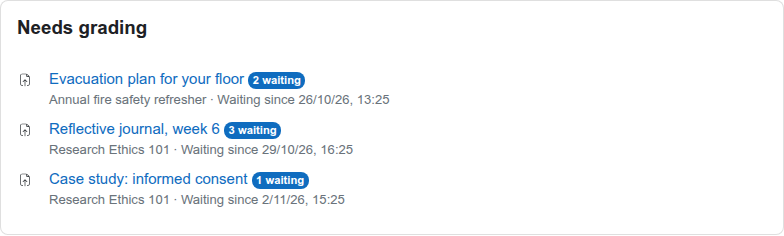

# Needs grading block for Moodle (block_gradingqueue)

One list of everything waiting for you to grade, across all your Moodle courses, oldest first. Put it on the Dashboard and stop opening every course to check.

## What it shows

| Work | Counted when |
| --- | --- |
| Assignment submissions | The latest submission is submitted and has no grade, or was changed after it was graded, as in Moodle's own count. Only students whose enrolment is active today. Group submission assignments are left out, as Moodle's own count does. |
| Quiz attempts | The attempt is finished but has no total yet, which means a question such as an essay is waiting for manual grading. |

Each line shows the activity, how many are waiting, the course, and how long the oldest has waited. The link opens the grading page for that activity. On the Dashboard it covers every course you can grade in; added to a course page, it shows that course only.

You only see activities where you hold `mod/assign:grade` or `mod/quiz:grade`. Counts are per activity; group restrictions apply on the grading page the link opens.

## Install

Needs Moodle 4.5 to 5.3.

1. Download the zip from [Releases](https://github.com/devlms/moodle-block_gradingqueue/releases) and install it under Site administration, Plugins, Install plugins. Or clone it into `blocks/gradingqueue` (Moodle 4.5 and 5.0) or `public/blocks/gradingqueue` (5.1 and later).
2. Visit Site administration, Notifications.
3. On your Dashboard, turn editing on and add the "Needs grading" block. Admins can add it to everyone's Dashboard under Site administration, Appearance, Default Dashboard page.

## Tests

PHPUnit covers ordering, graded work leaving the queue and returning on resubmission, quiz attempts waiting for manual grading, permissions, suspended students, the course filter and the block itself. Behat scenarios cover a teacher adding the block and opening the grading page, and a student seeing nothing. CI runs on Moodle 4.5 to 5.3 with PostgreSQL and MariaDB: [reports](https://devlms.github.io/moodle-block_gradingqueue/).

## Who made it

[DevLMS](https://devlms.com) builds custom Moodle plugins. Want forums, workshops or your own activity types in the list, or a grading workload report for managers? [Get a quote](https://devlms.com/#quote).

## Sponsors

<!-- sponsors:start -->
No sponsors yet. [Sponsor this plugin](https://devlms.com/sponsors/?plugin=block_gradingqueue): your name or logo, with a link to your site, goes here and on [devlms.com/sponsors](https://devlms.com/sponsors/).
<!-- sponsors:end -->

## License

GNU GPL v3 or later.
